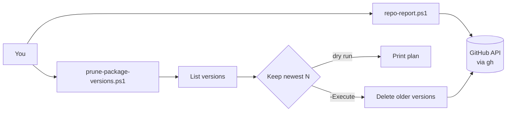

<div align="center">

# 🧰 GitHub Commands

**PowerShell toolkit for GitHub housekeeping — report on repositories and packages, and prune old package versions safely.**

[](https://github.com/mr-aybee/github-commands/actions/workflows/ci.yml)


[](LICENSE)

</div>

---

## Overview

Two focused scripts built on the GitHub CLI. `repo-report.ps1` produces a read-only inventory of repositories and package usage; `prune-package-versions.ps1` applies a keep-latest-N retention policy to GitHub Packages, running as a dry run until you explicitly pass `-Execute`.

## Features

- 📊 **Repository and package reporting** — read-only
- 🧹 **Retention pruning** — keep the newest *N* versions per package
- 🛡️ **Dry run by default** — nothing is deleted without `-Execute`
- 🔑 Uses your existing `gh auth` session; no tokens in scripts

## How it works



## Getting started

### Prerequisites

- PowerShell 7+
- [GitHub CLI](https://cli.github.com/) authenticated with `gh auth login` (add the `read:packages` / `delete:packages` scopes for pruning)

```shell
git clone https://github.com/mr-aybee/github-commands.git
cd github-commands
```

## Usage

```powershell
# Inventory repositories and packages
./repo-report.ps1

# Preview which versions would be removed (no changes)
./prune-package-versions.ps1 -Package My.Package -Keep 5

# Apply the retention policy
./prune-package-versions.ps1 -Package My.Package -Keep 5 -Execute
```

See [doc.md](doc.md) for every parameter, required scopes and more examples.

## Project structure

```text
github-commands/
├── repo-report.ps1              # Read-only reporting
├── prune-package-versions.ps1   # Retention management (dry run by default)
└── doc.md                       # Full command reference
```

## Development

- Lint locally with `Invoke-ScriptAnalyzer -Path . -Recurse`.
- CI parses every script and runs PSScriptAnalyzer on each push and pull request.

## Contributing

Contributions are welcome. Read [CONTRIBUTING.md](CONTRIBUTING.md) for the branch, build and pull-request workflow. Please report security issues privately through [GitHub security advisories](https://github.com/mr-aybee/github-commands/security/advisories/new), not public issues.

## Code of Conduct

This project follows the [Contributor Covenant](CODE_OF_CONDUCT.md). By participating you agree to uphold it.

## License

Released under the [MIT License](LICENSE). © 2026 Abdullah Shahid.
